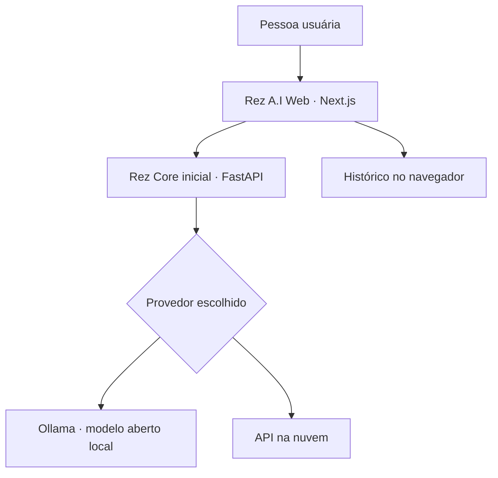

<div align="center">

# REZ A.I — Projeto de Inteligência Artificial Avançada 🤖

### Engenharia reversa responsável. Pesquisa aberta. Inteligência em evolução.

**Uma plataforma de IA híbrida construída para aprender com a pesquisa de ponta e evoluir com evidências.**


[Visão](#-visão-do-projeto) · [Arquitetura](#-arquitetura-híbrida) · [Executar](#-executar-localmente) · [Pesquisa](#-pesquisa-e-engenharia-reversa) · [Roadmap](#-roadmap)

</div>

---

## 🌌 Visão do projeto

A **Rez A.I** é um projeto independente de pesquisa e engenharia de software para construir uma plataforma de inteligência artificial **híbrida, extensível e multiplataforma**.

Começamos com uma experiência de chat na web, um backend em Python e suporte a modelos **locais via Ollama** e **na nuvem via API**. O plano é avançar para memória, ferramentas, agentes, avaliações, aplicações móveis e experimentos com modelos abertos.

> **Nossa ambição:** levar a Rez A.I ao maior nível técnico possível por meio de engenharia reversa **de implementações e técnicas publicamente disponíveis**, experimentação e melhorias mensuráveis. Isso é uma meta de pesquisa — não uma afirmação de que o projeto já supera sistemas de fronteira.

## 🖤 Identidade

| | |
|---|---|
| **Projeto** | Rez A.I |
| **Conceito** | Assistente de IA híbrido, aberto à evolução |
| **Estilo visual** | Full Black Premium — preto profundo e acentos violetas |
| **Plataforma atual** | Aplicação web |
| **Plataformas futuras** | Android, iOS e desktop |
| **Criador** | [João Miguel](https://github.com/jmrzd) |

## ⚡ Estado atual — v0.1.0

**Já implementado no código inicial:**
- Interface de chat responsiva em Next.js, React e TypeScript;
- Criação, seleção e exclusão de conversas;
- Histórico armazenado localmente no navegador (`localStorage`);
- Backend FastAPI com endpoint de saúde (`GET /health`) e chat (`POST /chat`);
- Escolha manual de provedor: **Ollama (local)** ou **API da OpenAI (nuvem)**;
- Configuração de modelo local por variáveis de ambiente.

**Ainda não implementado:** autenticação, banco de dados, streaming, memória inteligente, RAG, agentes, seleção automática de modelos e treinamento. A integração completa ainda precisa ser validada em execução local.

## 🧩 Arquitetura híbrida



Na v0.1, **a escolha do modelo é manual**. O roteamento inteligente e o motor de agentes são propostas futuras. Consulte [docs/ARCHITECTURE.md](docs/ARCHITECTURE.md).

## 🛠️ Tecnologias

| Camada | Tecnologia | Estado |
|---|---|---|
| Web | Next.js, React, TypeScript, CSS | Protótipo |
| Backend | Python, FastAPI, HTTPX | Protótipo |
| Modelos locais | Ollama (modelo configurável) | Integração inicial |
| Modelos na nuvem | API OpenAI | Integração opcional |
| Histórico | localStorage | Apenas local |
| Persistência | PostgreSQL | Planejado |
| Mobile | React Native | Planejado |

## 💻 Executar localmente

Requisitos: **Node.js 20+**, **Python 3.10+**, npm e, para IA local, [Ollama](https://ollama.com).

Clone usando o **nome real do repositório**:

```bash
git clone https://github.com/jmrzd/REZ-A.I.git
cd REZ-A.I
```

### Backend

```bash
cd backend
python -m venv .venv
```

Ative o ambiente virtual:

```bash
# Linux/macOS
source .venv/bin/activate
# Windows PowerShell
# .venv\Scripts\Activate.ps1
```

Instale e configure:

```bash
pip install -r requirements.txt
# Linux/macOS:
cp .env.example .env
# Windows PowerShell: Copy-Item .env.example .env
uvicorn main:app --reload
```

API: **http://localhost:8000** · Saúde: **http://localhost:8000/health**

### Modelo local — Ollama

Após instalar/iniciar o Ollama, em outro terminal:

```bash
ollama pull qwen3:1.7b
```

Esse é um **ponto de partida leve**; outros modelos podem ser configurados em `backend/.env` via `OLLAMA_MODEL` (por exemplo, uma variante de DeepSeek-R1 compatível com seu computador). O uso de cada modelo depende de memória, hardware e licença.

### Modelo na nuvem

Opcionalmente, defina `OPENAI_API_KEY` em `backend/.env`. **Nunca faça commit desse arquivo**. O backend mantém as chaves do lado do servidor.

### Frontend

Abra um segundo terminal na raiz do repositório:

```bash
cd frontend
npm install
npm run dev
```

Abra **http://localhost:3000**. Se a API não estiver em `localhost:8000`, configure `NEXT_PUBLIC_API_URL` no frontend.

## 🔬 Pesquisa e engenharia reversa

A Rez A.I pretende **estudar e reproduzir ideias permitidas pelas licenças** de projetos abertos, incluindo trabalhos das famílias **DeepSeek**, **Qwen** e **Kimi**, além de outras referências relevantes.

Eixos de investigação:
1. **Arquiteturas** — Transformers, Mixture of Experts, atenção e eficiência;
2. **Raciocínio e código** — avaliação de respostas, matemática e programação;
3. **Inferência** — quantização, desempenho local, latência e custos;
4. **Orquestração** — ferramentas, RAG, agentes e escolha de modelos;
5. **Avaliação reproduzível** — datasets permitidos, métricas e testes;
6. **Confiabilidade** — privacidade, resistência a prompt injection e segurança.

Pesquisa não equivale a copiar serviços fechados, contornar controles, obter pesos privados ou ignorar licenças. **Código público não é necessariamente software livre;** cada repositório, checkpoint e dataset exige verificação específica de seus termos.

Veja nosso [plano de pesquisa](docs/RESEARCH.md) e a [visão de funcionalidades](docs/PRODUCT_VISION.md).

## 🌐 Diferencial: Rez Universal Assistant

A experiência desejada não exige comandos rígidos nem repetir o nome da assistente em cada frase. A Rez deve compreender solicitações naturais **dentro de uma sessão ativa**, levar em conta o contexto e executar apenas ações permitidas.

> "Abre aí o Spotify, meu parceiro." → abrir Spotify.
>
> "Rez, abre o YouTube." / "Agora abre o Spotify também." / "Volta pra primeira aba." → reconhecer o contexto e, com integração de navegador autorizada, retornar à aba anterior.
>
> "Hey Rez, open my mail." / "Abre mi correo." → entender a intenção mesmo em outros idiomas.

**Hoje:** o OS Agent interpreta somente frases simples por regras, a partir de um terminal, e abre sites predefinidos. **Futuro:** NLU com modelos abertos, contexto de sessão, voz, integrações com navegador e aplicativos.

A implementação deverá diferenciar:
- **Modo texto:** comandos diretos sem chamar "Rez";
- **Ativação por voz:** "Hey Rez" e atalhos;
- **Conversa contínua (opt-in):** dispensar a palavra de ativação durante uma sessão delimitada;
- **Escuta contínua opcional:** somente com indicação visível, controle de microfone e proteção contra ativações acidentais.

📚 **Documentação detalhada**
- [Visão do produto e exemplos de interação](docs/PRODUCT_VISION.md)
- [Linguagem natural, contexto e voz](docs/NATURAL_LANGUAGE.md)
- [Integração Windows, Linux e navegadores](docs/OS_INTEGRATION.md)
- [Plugins, conectores e agentes](docs/PLUGINS_AND_AGENTS.md)
- [Privacidade, permissões e segurança](docs/SECURITY.md)
- [Plano de implementação e critérios de aceite](docs/ROADMAP.md)

## 🗺️ Roadmap

- [x] Repositório e identidade Rez A.I;
- [x] Código inicial de interface **Full Black Premium**;
- [x] API de chat com seleção manual entre modelo local e nuvem;
- [ ] Testes de ponta a ponta e correções;
- [ ] Streaming e tratamento aprimorado de erros;
- [ ] PostgreSQL e sincronização segura de conversas;
- [ ] Contas, autenticação e limites de uso;
- [ ] Suporte a arquivos, busca e RAG;
- [ ] Memória com controles de privacidade;
- [ ] Benchmarks entre modelos abertos;
- [ ] Roteamento por qualidade, custo e latência;
- [x] OS Agent inicial para comandos fixos e abertura de URLs permitidas (teste manual reportado no Windows, sem validação automatizada em todas as versões);
- [ ] Linguagem natural para frases livres, gírias e idiomas variados;
- [ ] Contexto entre comandos, navegação de abas e aplicativos;
- [ ] Voz, ativação opcional e sessão conversacional;
- [ ] Plugins com permissões e conectores externos;
- [ ] Agentes e ferramentas especializadas;
- [ ] Aplicativos Android, iOS e desktop;
- [ ] Experimentos de fine-tuning, dentro dos recursos e licenças disponíveis.

## 🔐 Segurança e limitações

**MVP para ambiente local; ainda não está pronto para expor a internet pública.**

- Não armazene dados sensíveis nas conversas de teste (histórico no navegador).
- Não publique `.env`, credenciais, tokens ou chaves de API.
- Não configure chaves secretas com prefixo `NEXT_PUBLIC_`.
- Antes de lançar publicamente: autenticação, rate limiting, observabilidade, isolamento de ferramentas, validação de entradas e controles de custo.

## 📂 Estrutura

```text
REZ-A.I/
├── backend/
│   ├── main.py
│   ├── requirements.txt
│   └── .env.example
├── frontend/
│   ├── app/
│   │   ├── page.tsx
│   │   ├── layout.tsx
│   │   └── style.css
│   ├── package.json
│   └── tsconfig.json
├── os-agent/
│   ├── agent.py
│   ├── tests/
│   └── README.md
├── docs/
│   ├── ARCHITECTURE.md
│   ├── RESEARCH.md
│   ├── PRODUCT_VISION.md
│   ├── NATURAL_LANGUAGE.md
│   ├── OS_INTEGRATION.md
│   ├── PLUGINS_AND_AGENTS.md
│   ├── SECURITY.md
│   └── ROADMAP.md
├── .gitignore
└── README.md
```

## 📜 Licença e atribuições

A licença **do código autoral deste repositório ainda será definida**; disponibilizá-lo publicamente não autoriza, por si só, reutilização irrestrita. Pesos/modelos/dados de terceiros possuem licenças próprias. **Rez A.I não é afiliada à DeepSeek, Qwen, Moonshot AI ou OpenAI.**

---

<div align="center">

**REZ A.I — Inteligência em evolução. Engenharia com propósito. 🖤**

Criado por [João Miguel](https://github.com/jmrzd)

</div>
