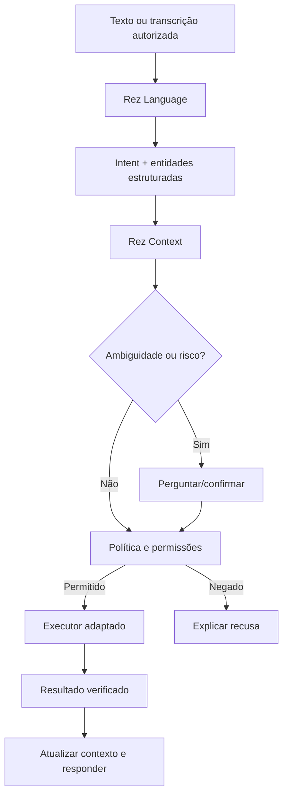

# Linguagem natural, contexto e voz

## Objetivo

Trocar o parser atual de palavras fixas por um interpretador de **intenção** baseado em modelos abertos ou APIs selecionadas. A pessoa poderá falar informalmente, inclusive com gírias, sem uma frase exata e, em sessões ativas, sem dizer o nome Rez.

O modelo **não** recebe poder de executar código arbitrário: ele sugere uma ação estruturada, que é validada por políticas e executada por uma ferramenta de permissões limitadas.

## Exemplos de equivalência semântica

- PT-BR: "Abre o Spotify", "Bota o Spotify aí", "Abre o Spotify, meu parceiro", "Quero ouvir música no Spotify".
- EN: "Open Spotify", "Could you launch Spotify?", "Take me to Spotify".
- ES: "Abre Spotify", "Pon Spotify", "Abre mi correo" (Gmail depende de preferência configurada).

Não assumir que "quero ouvir música" significa Spotify automaticamente: se houver vários serviços, consultar a preferência ou pedir esclarecimento.

## Protocolo proposto de intenção (não implementado)

```json
{
  "schema_version": "0.1",
  "intent": "open_service",
  "target": "spotify",
  "language": "pt-BR",
  "confidence": 0.97,
  "requires_confirmation": false
}
```

**A pontuação acima é apenas ilustrativa, não uma medição real.** Jamais confiar apenas na confiança autoestimada de um LLM para aprovar ações sensíveis.

Intenções iniciais: `open_service`, `open_application`, `focus_tab`, `switch_window`, `search_web`, `clarify` e `no_action`.

Cada intenção deve possuir schema estrito, alvos permitidos, política de autorização e executor dedicado. Argumentos são **dados**, nunca comandos de shell.

## Contexto de sessão

Dados mínimos a manter por tempo limitado e sob controle do usuário:

- ID da sessão e idioma preferido;
- últimas intenções e resultados, não somente frases;
- identificadores confiáveis de janelas e abas autorizadas;
- lista de ações efetivamente concluídas, com timestamp;
- referências ("primeira aba", "a anterior", "aquele site") vinculadas a recursos reais.

**Exemplo:**

1. "Abre o YouTube" → navegador devolve `tab_id=A`.
2. "Agora abre o Spotify também" → navegador devolve `tab_id=B`.
3. "Volta pra primeira aba" → resolver `A`, verificar se a aba existe e focar `A`.

Sem extensão autorizada, IDs de abas ou estado verificado, a Rez não pode garantir essa operação. Deve explicar a limitação ou pedir ajuda, **não inventar sucesso**.

## Fluxo proposto



## Modos de voz propostos

| Modo | Acionamento | Risco/observação |
|---|---|---|
| Texto | Mensagem digitada | Não exige "Rez" |
| Push-to-talk | Atalho/botão | Mais previsível e privado |
| Wake word | "Hey Rez" | Detector local com ativação explícita |
| Sessão contínua | Após ativação até encerrar/expirar | Não repetir nome; indicador sempre visível |
| Escuta contínua | Opt-in separado | Alta sensibilidade de privacidade; não habilitar por padrão |

**Política obrigatória:** fácil silenciar, interromper sessão, inspecionar estado do microfone e impedir armazenamento/transmissão desnecessários. A primeira versão de voz deve ser push-to-talk ou wake word local.

## Como avaliar

Criar corpus de testes por idioma com variações, gírias, erros de digitação, negações, pedidos ambíguos e comandos maliciosos. Medir accuracy por intenção, recuperação de referência, falsos positivos de execução, tempo de resposta e taxa de solicitações de confirmação. Testar explicitamente frases que **não** devem abrir aplicativos.

## Primeiros marcos

1. Criar dataset de frases rotuladas (PT/EN/ES).
2. Expor uma interface `parse_intent(text, context) -> structured intent`.
3. Prototipar com Qwen/DeepSeek compatível com hardware ou API opt-in.
4. Aplicar allowlists e política de execução no agente.
5. Acrescentar memória temporária de sessão.
6. Depois: integração com extensão de navegador, voz e personalização de idiomas.
