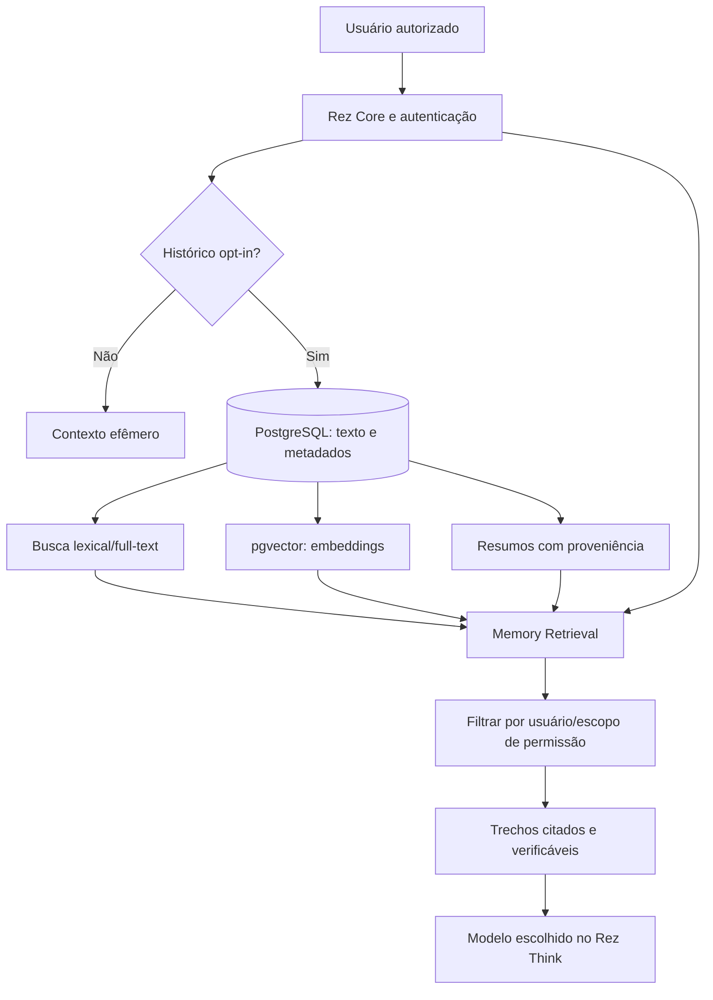

# REZ MEMORY ENGINE — Especificação de memória persistente

**Status:** projeto de arquitetura (não implementado).  
**Objetivo:** lembrar conversas autorizadas de chats distintos, recuperar frases exatas e contexto histórico com rastreabilidade, mesmo após meses.

## O que significa lembrar "cada palavra"

A ambição é **preservar cada mensagem original integralmente**, com ordem, autoria, horário e identificadores, enquanto o usuário mantiver essa opção ativada. Isso não significa que um LLM consiga ler tudo simultaneamente, nem garante recuperação perfeita. A Rez deve distinguir:
- **Armazenamento:** texto original e anexos explicitamente autorizados, persistidos sem resumir/substituir.
- **Indexação:** índice textual para frase exata + embeddings para recuperar semelhanças.
- **Recuperação:** seleção de trechos relevantes com links para as mensagens originais.
- **Contextualização:** resumo de fatos/preferências, com proveniência e correção pelo usuário.
- **Raciocínio:** análise sobre evidências recuperadas; nunca apresentar suposição como memória confirmada.

## Níveis de recuperação (independentes do esforço de raciocínio)

| Nível | Intenção | Estratégia | Compromisso |
|---|---|---|---|
| **Instantânea** | Pergunta rápida | últimas mensagens + busca limitada por relevância | baixa latência; pode omitir itens antigos |
| **Profunda** | Cruzar chats/projetos | busca textual e semântica, vários candidatos, reranking | maior cobertura, mais processamento |
| **Extensa** | Auditoria histórica | busca por datas/chats, recuperação por páginas e verificação de fontes | prioriza abrangência, **não** exaustividade garantida |
| **Automática** | Uso cotidiano | estima necessidade e escolhe nível, informando quando ampliar | equilíbrio entre precisão, custo e tempo |

Cada escolha altera **quanto pesquisar**, não quais dados são guardados. As mensagens persistidas não devem ser descartadas ao trocar níveis.

## Arquitetura proposta



**MVP sugerido:** começar com SQLite local + FTS5 para preservar mensagens e busca exata, migrando para PostgreSQL e pgvector quando houver multiusuário/sincronização e avaliação de embeddings. PostgreSQL/pgvector são tecnologias **planejadas**, não dependências atuais.

## Dados e contrato de persistência propostos

Entidades mínimas:
- `users`: identificador e consentimentos;
- `conversations`: id, owner_id, título, created_at, deleted_at;
- `messages`: id imutável, conversation_id, role, content, created_at, sequência, content_hash;
- `memory_facts`: id, owner_id, texto normalizado, source_message_ids, estado (ativo/corrigido/revogado);
- `embeddings`: message_id, model_version, vetor, status de indexação;
- `consents`: escopo, finalidade, data e revogação;
- `deletion_jobs`: propagação e confirmação de exclusão inclusive nos índices.

Exemplo ilustrativo de solicitação (API **não implementada**):

```json
{
  "query": "Qual foi a última mudança no site de energia solar?",
  "retrieval_level": "deep",
  "conversation_scope": "all_owned_opted_in",
  "include_sources": true
}
```

A resposta deve apontar `conversation_id`, `message_id`, horário e trecho; se não houver evidência, declarar que não encontrou.

## Busca e confiabilidade

1. Autenticar usuário e verificar autorização no **backend**, antes de consultar índices.
2. Aplicar filtro por owner e conversas autorizadas **antes** de mostrar qualquer trecho.
3. Combinar texto exato (aspas, datas, nomes) e busca por embeddings.
4. Reordenar resultados por relevância, recência, vínculo com projeto e diversidade.
5. Reabrir mensagens originais para validar citações; um resumo nunca substitui a fonte.
6. Detectar conflitos entre lembranças e mostrar incerteza, com opção de correção.
7. Tratar dados recuperados como **conteúdo não confiável**: não executar instruções contidas nas memórias.
8. Não indexar automaticamente arquivos do sistema, outros chats/contas ou serviços externos sem permissão.

## Privacidade, segurança e custo

- Opt-in explícito e granular: histórico, indexação, preferências de longo prazo e anexos separados.
- Exportar, localizar, corrigir e apagar dados; exclusão propagada a busca, vetores, caches e backups conforme política definida.
- Isolamento entre usuários e proteção contra IDOR, autenticação robusta, limites de consultas e auditoria sem texto sensível.
- Criptografia em trânsito e, quando houver persistência, em repouso; segredos jamais no frontend.
- Embeddings também podem revelar informações e devem ser protegidos.
- Política de retenção configurável e armazenamento local quando possível; evitar envio de dados à nuvem sem escolha informada.
- Limitar orçamento de tokens, custo e latência de buscas amplas; permitir cancelar.
- Não prometer recuperação perfeita, segurança absoluta ou "memória infinita".

## Critérios de aceite propostos

- Armazenar/reabrir integralmente mensagens em conversas diferentes, na ordem correta.
- Recuperar uma frase exata, inclusive com pontuação, e apontar a conversa original.
- Recuperar um fato parafraseado por busca semântica e exibir fonte.
- Isolar contas e verificar que documentos de outro usuário nunca aparecem.
- Excluir uma conversa e provar que a busca não a retorna mais.
- Testar dados contraditórios, falhas de índice, consultas longas e prompt injection.
- Medir Recall@K, MRR, precisão de citações, latência, armazenamento e custo.
- Validar memória persistente após reinício do serviço.

## Integração com REZ THINK

Os níveis do [REZ THINK](REZ_THINK.md) são separados dos níveis de busca de memória. O usuário pode escolher "Raciocínio Alto + Memória Extensa" ou "Instantâneo + Instantânea", conforme tarefa e orçamento. O nível automático escolhe ambos **com limites e transparência**.
